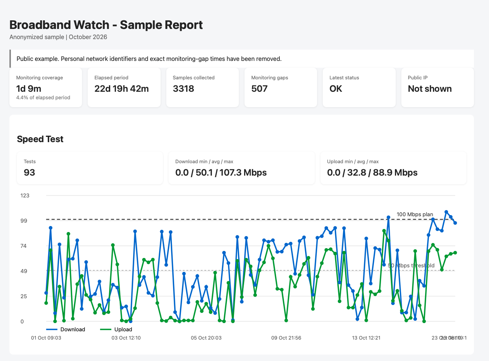

# Broadband Watch

A local-first broadband monitor for macOS that quietly watches your home connection and turns noisy network symptoms into readable daily evidence.

[](sample-report-2026-10.html)

Broadband Watch helps you answer a simple question: is your internet slow because of your Wi‑Fi, your router, DNS, or your ISP? It runs in the background, checks connectivity and latency on a schedule, performs periodic speed tests, and saves HTML reports you can open locally on your Mac.

## Table of Contents

- [Why use it](#why-use-it)
- [What it measures](#what-it-measures)
- [Quick start](#quick-start)
- [Configuration](#configuration)
- [Reports and data](#reports-and-data)
- [Privacy and limits](#privacy-and-limits)
- [About the project](./ABOUT.md)

## Why use it

Most home internet problems are hard to diagnose from a single speed test. Broadband Watch gives you a timeline instead of a snapshot.

- See whether slowdown is tied to Wi‑Fi signal strength or router latency
- Track packet loss and DNS delay over time
- Notice recurring degradation before it becomes a daily annoyance
- Keep all measurements local on your own machine
- Compare raw data and daily reports without sending private network details to a service

## What it measures

- Router and internet latency, packet loss, and reachability
- Wi‑Fi signal information when macOS makes it available
- DNS response time using Cloudflare and Google public DNS
- Download and upload speed, tested periodically and during suspected degradation
- Public IP changes, recorded locally for diagnostics

The monitor samples about every 30 seconds and runs a speed test about every 30 minutes. These checks add network traffic; speed tests can use a noticeable amount of data.

## Quick start

Requirements: macOS, a logged-in user session, Python 3 (`python3`), and internet access during setup.

From the project directory, run:

```sh
bash setup_broadband_monitor.sh
```

The installer creates `~/broadband-monitor/`, creates a Python virtual environment, installs `speedtest-cli`, and registers a per-user `launchd` service. The service starts at login and restarts if it exits. Administrator privileges are not required.

## Configuration

Before installation, edit the configuration near the beginning of [`setup_broadband_monitor.sh`](setup_broadband_monitor.sh):

| Setting | Purpose | Default |
| --- | --- | --- |
| `ROUTER_IP` | Local address of your router | `192.168.0.1` |
| `WIFI_INTERFACE` | Wi‑Fi interface name on this Mac | `en0` |
| `EXPECTED_DOWNLOAD` | Expected plan download speed, Mbps | `100.0` |
| `EXPECTED_UPLOAD` | Expected plan upload speed, Mbps | `100.0` |

Update the router address and plan speeds to make the reports meaningful for your connection.

## Reports and data

The monitor keeps its output on your Mac under `~/broadband-monitor/`:

| Path | Contents |
| --- | --- |
| `reports/index.html` | Index of available daily reports |
| `reports/YYYY-MM-DD.html` | Daily charts and diagnostic summary |
| `data/measurements.csv` | Raw measurements |
| `data/public_ip_history.csv` | Public IP change history |
| `logs/events.log` | Status changes and monitor events |

Open the report index with:

```sh
open ~/broadband-monitor/reports/index.html
```

Remove the background service without deleting collected measurements:

```sh
~/broadband-monitor/venv/bin/python ~/broadband-monitor/broadband_monitor.py --uninstall
```

## Privacy and limits

Measurements, logs, and reports are stored locally. The monitor contacts public services for the public IP check, internet connectivity check, DNS checks, and speed tests. The sample report is anonymized: its public IP, exact reporting window, and detailed monitoring-gap timestamps have been removed.

Network measurements can help distinguish local Wi‑Fi/router symptoms from broader internet symptoms, but they do not independently prove that an ISP is at fault. Treat reports as diagnostic evidence, not a service guarantee.

## About the project

This project is intentionally small, local, and practical: it is designed to run on a Mac without cloud services, account setup, or subscription fees. If you want to understand your internet quality over time, Broadband Watch offers a useful middle ground between a one-off speed test and full enterprise network monitoring.

This project was created with a little help from several AI coding assistants, and it stands as a small thank-you to the tools that made prototyping, debugging, and polishing much easier. The goal is simple: useful software, built with a lighter touch and a lot of iteration.

Want to learn more? See [ABOUT.md](./ABOUT.md).